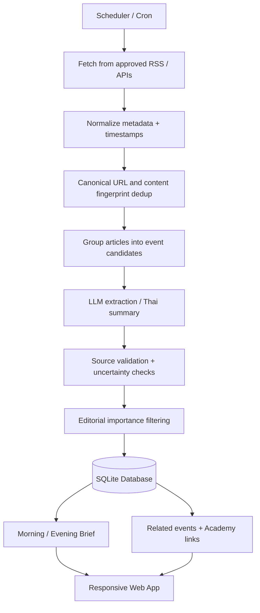

# Worldview — Product Requirements & Technical Specification

> **Status:** Draft v0.1 · **Document type:** Product Requirements Document (PRD) + MVP Technical Design  
> **Working name:** Worldview (เปลี่ยนชื่อได้ภายหลัง)  
> **Target platform:** Mobile-first Responsive Web Application  
> **Primary language:** Thai; support English names, keywords and original-source links  
> **Timezone for user-facing dates and schedules:** `Asia/Bangkok` (UTC+07:00)  
> **Last updated:** 2026-11-13

---

## 1. Project Overview

### 1.1 Vision

สร้าง Web Application สำหรับ **เรียนรู้โลกจากพื้นฐาน และติดตามเหตุการณ์โลกอย่างต่อเนื่อง** โดยเชื่อมความรู้เชิงโครงสร้าง (ประวัติศาสตร์ เศรษฐศาสตร์ ภูมิรัฐศาสตร์ ฯลฯ) เข้ากับข่าวรายวันและเหตุการณ์ย้อนหลัง เพื่อให้ผู้ใช้เข้าใจไม่เพียงว่า *เกิดอะไรขึ้น* แต่รวมถึง *ทำไมจึงเกิดขึ้น* และ *เกี่ยวข้องกับเหตุการณ์อื่นอย่างไร*

**Product principle:** *Don't just read the news. Understand why it matters.*

เว็บนี้ **ไม่ใช่** เว็บคัดลอกบทความข่าว และ **ไม่ใช่** ระบบแนะนำว่าผู้ใช้ควรเชื่อหรือเลือกจุดยืนทางการเมืองใด แต่เป็นเครื่องมือช่วยสำรวจแหล่งข้อมูล เปรียบเทียบหลักฐาน และสร้างความเข้าใจด้วยตนเอง

### 1.2 Objectives

1. มีคลังบทเรียนถาวร **Roadmap 30 วัน / 4 สัปดาห์** ที่เปิดอ่านซ้ำได้ทุกเวลา
2. มีหน้า **Daily Brief** สรุปข่าวโลกที่สำคัญเป็นภาษาไทย โดยมีวันที่ หมวดหมู่ บริบท และลิงก์อ้างอิง
3. เปิดดู **ข่าวย้อนหลังรายวัน** และติดตามการเปลี่ยนแปลงของเหตุการณ์เดียวกันได้
4. เชื่อมความสัมพันธ์ระหว่าง **ข่าว–ข่าว / ข่าว–เหตุการณ์ / ข่าว–บทเรียน** พร้อมคำอธิบายว่าทำไมจึงเกี่ยวข้องกัน
5. ใช้ **LLM ภายนอกผ่าน Model ID + Endpoint ที่จะกำหนดภายหลัง** เพื่อช่วยประมวลผลอย่างประหยัดและควบคุมค่าใช้จ่ายได้
6. ออกแบบให้ **Mobile-first, Responsive, อ่านง่าย และใช้งานลื่นบนเครื่องสเปกปานกลาง**

### 1.3 Target Users

- ผู้ที่สนใจข่าวและสถานการณ์โลก แต่ยังไม่มีความรู้พื้นฐานมากนัก
- ผู้ที่ต้องการอ่านสรุปข่าวแบบมีบริบท ไม่ต้องไล่อ่านหลายเว็บไซต์
- ผู้ที่อยากติดตามพัฒนาการของเหตุการณ์ในช่วงหลายวันหรือหลายเดือน
- ผู้ใช้บนสมาร์ตโฟนเป็นหลัก และใช้ Desktop/Web Browser เป็นรอง

### 1.4 MVP Success Criteria

- เปิดอ่านบทเรียนทั้ง 30 วันได้บนมือถือและคอมพิวเตอร์
- เห็น Daily Brief ประจำวันและเลือกย้อนหลังตามวันที่ได้
- ทุกเหตุการณ์ที่เผยแพร่มี **อย่างน้อย 1 แหล่งอ้างอิงที่ตรวจสอบได้**; ประเด็นสำคัญที่มีข้อโต้แย้งควรมีหลายแหล่งหากหาได้
- ข่าวที่ซ้ำกันจากหลายสำนักถูกจัดเข้า **Event เดียว** ไม่แสดงซ้ำเป็นหลายข่าวโดยไม่จำเป็น
- ระบบดึงข่าวตามเวลาอัตโนมัติได้ และรันงานซ้ำโดยไม่สร้างข้อมูลซ้ำ
- แสดงความเชื่อมโยงของเหตุการณ์เมื่อมีหลักฐานเพียงพอ และบอกเหตุผลของการเชื่อมโยงได้
- หาก LLM หรือ News Provider ใช้งานไม่ได้ หน้าเว็บยังอ่านข้อมูลเดิมได้ และแสดงเวลาที่อัปเดตล่าสุด

---

## 2. Product Scope & Information Architecture

### 2.1 Main Navigation

| Page / Route (proposed) | Description | MVP? |
|---|---|---|
| `/` | Home: วันนี้ควรรู้อะไร + บทเรียนที่กำลังอ่าน | Yes |
| `/academy` | Roadmap 30 วัน แยกเป็น 4 สัปดาห์ | Yes |
| `/academy/week/[week]/day/[day]` | อ่านบทเรียนรายวัน พร้อมประเด็นสำคัญ คำศัพท์ ตัวอย่าง และคำถามทบทวน | Yes |
| `/brief` | Daily Brief ล่าสุด | Yes |
| `/brief/[date]` | Daily Brief ย้อนหลัง เช่น `/brief/2026-11-12` | Yes |
| `/events/[id]` | รายละเอียดเหตุการณ์ ประวัติอัปเดต ข่าวต้นทาง และข่าวที่เกี่ยวข้อง | Yes |
| `/archive` | ปฏิทินข่าวย้อนหลัง + ตัวกรองหมวดหมู่/ภูมิภาค | Yes |
| `/connections` | Interactive Knowledge Graph | Phase 2; MVP แสดง related links แบบรายการก่อน |
| `/search` | ค้นหาบทเรียนและเหตุการณ์ | Basic search in MVP |
| `/admin` | ตรวจสถานะ jobs, แก้ไข/ซ่อนรายการที่ไม่เหมาะสม, ตรวจข่าวที่รอตรวจ | Minimal protected admin |

### 2.2 Navigation / UX Structure

- **Mobile:** Bottom navigation สำหรับ `Today`, `Academy`, `Archive`, `Search` (และ `Connections` เมื่อเปิดใช้งาน)
- **Desktop:** Sidebar หรือ top navigation; พื้นที่อ่านแบบ responsive และจำกัดความกว้างเนื้อหาเพื่ออ่านสบาย
- บนหน้า Today ให้มี quick links ไปยังข่าวย้อนหลัง, บทเรียนที่เกี่ยวข้อง และเหตุการณ์ที่กำลังติดตาม
- ทุกหน้ารองรับ deep link, browser back/forward, การแชร์ URL และ metadata สำหรับ social preview

---

## 3. Functional Requirements

### FR-01: World Academy — 30-Day Knowledge Roadmap

คลังความรู้ถาวร 30 วัน แบ่งเป็น 4 สัปดาห์ โดยเนื้อหาจัดการแบบไฟล์ Markdown/MDX (หรือข้อมูล seed ในฐานข้อมูล) เพื่อให้แก้ไขและ version-control ได้ง่าย ไม่ต้องใช้ CMS ตั้งแต่แรก

**Core curriculum:**

| Week | Theme | Example Topics | Expected Outcome |
|---|---|---|---|
| 1 | ประวัติศาสตร์โลกและภูมิรัฐศาสตร์ | สงครามโลก, สงครามเย็น, สหรัฐฯ–จีน, UN, NATO, ASEAN | เข้าใจโครงสร้างอำนาจและพันธมิตร |
| 2 | เศรษฐกิจโลก | GDP, เงินเฟ้อ, ดอกเบี้ย, Fed, เงินตรา, การค้าและ Supply Chain | อ่านข่าวเศรษฐกิจและตีความผลกระทบ |
| 3 | ความขัดแย้งและทรัพยากร | ตะวันออกกลาง, รัสเซีย–ยูเครน, ไต้หวัน, น้ำมัน, Semiconductor | เข้าใจความสัมพันธ์ระหว่างความมั่นคงกับเศรษฐกิจ |
| 4 | อนาคตและการคิดเชิงวิพากษ์ | AI, Climate, ประชากร, Cybersecurity, Media Literacy | ตรวจสอบหลักฐานและพัฒนาเหตุผลของตัวเอง |

**Note:** แผนนี้กำหนด **30 บทเรียนรายวันจริง** ไม่ใช่แค่หัวข้อ 4 สัปดาห์; กระจายวันได้ เช่น 7/7/7/9 และให้ content outline เป็นข้อมูลที่ปรับได้

**Lesson fields:** `id`, `week`, `day`, `slug`, `title`, `summary`, `learning_objectives`, `content_markdown`, `glossary`, `key_questions`, `further_reading`, `related_tags`, `last_reviewed_at`

**Must have:**
- รายการบทเรียนและสถานะวัน/สัปดาห์
- อ่านบทเรียนแบบ long-form โดยรองรับสารบัญย่อย และลิงก์แหล่งอ้างอิง
- ลิงก์จากบทเรียนไปยังข่าว/เหตุการณ์ปัจจุบันที่เกี่ยวข้อง
- Quiz หรือ Reflection Questions ท้ายบทเรียน (เก็บผลส่วนบุคคลเป็น Phase 3)
- แยกเนื้อหาพื้นฐานที่ค่อนข้างคงที่ออกจากตัวอย่างข่าวที่เปลี่ยนทุกวัน

### FR-02: Daily Intelligence / Brief

แสดง **เหตุการณ์สำคัญ** ที่ผ่านกระบวนการคัดเลือก ไม่ใช่ดึง headline ทุกชิ้นมาเรียงต่อกัน

**Proposed daily target:** ประมาณ **10–15 events/day** (ปรับได้) โดยหลีกเลี่ยงการให้ความสำคัญเฉพาะข่าวที่ถูกแชร์มาก

**Event card fields:**
- Title ภาษาไทย, 1–2 ประโยคสรุป, `last_updated`, category, country/region, tags
- `What happened?` — สิ่งที่ยืนยันได้
- `Why it matters?` — ผลกระทบและบริบท
- `Background` — ที่มาของเหตุการณ์
- `What remains uncertain?` — สิ่งที่ยังไม่ชัดเจนเมื่อมี
- Sources: ชื่อสำนักข่าว, เวลาเผยแพร่, URL ต้นทาง
- Related events + related academy lessons

**Content policy:**
- ถ้าข่าวยังมีข้อขัดแย้ง ให้แยกคำกล่าวอ้างของแต่ละฝ่ายและระบุผู้กล่าว
- หลีกเลี่ยงคำชี้นำและการใช้ LLM ตัดสินฝ่ายการเมืองที่ “ถูก/ผิด” โดยไม่มีหลักฐาน
- ห้ามแต่งรายละเอียดหรือแหล่งอ้างอิง หากข้อมูลไม่พอให้ระบุว่าไม่แน่ชัด
- ไม่สรุปเนื้อหาจาก URL ที่ไม่สามารถอ่านข้อมูลได้จริง

### FR-03: Historical Archive & Date Navigation

- เลือกวันที่ย้อนหลังจาก calendar/date picker
- Filter: หมวดหมู่ ภูมิภาค ประเทศ แท็ก
- มี daily snapshot และ timestamp ว่า brief ถูกสร้าง/อัปเดตเมื่อใด
- ข่าวที่เผยแพร่ช้าหรือมีการแก้ไขย้อนหลังต้องไม่ทำให้เกิดความเข้าใจผิดเกี่ยวกับลำดับเวลา
- URL แบบวันที่ (`YYYY-MM-DD`) และใช้ `Asia/Bangkok` สำหรับการจัดกลุ่มวัน

### FR-04: Event Timeline & Related News

- หนึ่ง **Event** มีหลาย Articles และหลาย Updates ได้
- หน้ารายละเอียดแสดง timeline ของ event, การอัปเดต และหลักฐานสนับสนุน
- ความสัมพันธ์ระหว่าง events รองรับประเภท เช่น `same_topic`, `follow_up`, `response_to`, `background_of`, `potential_impact`
- ใน MVP ใช้ **Related Events list** ก่อน; Phase 2 จึงใช้ graph แบบ interactive
- การสร้าง `causes` / ความสัมพันธ์แบบเหตุ–ผล ต้องมีแหล่งยืนยันและผ่านการตรวจที่เข้มกว่าเพียงความคล้ายของข้อความ

### FR-05: Search & Discovery

- Keyword search ของ headlines, summaries, article metadata และ Academy contents
- Full-text search ด้วย SQLite FTS5 สำหรับ MVP
- กรองตามวัน, category, region, tag
- Semantic search/embedding เป็น Phase 2 **หลัง** มี evidence ว่าค้นหาแบบข้อความไม่เพียงพอ

### FR-06: Admin & Observability

- Admin login แบบเรียบง่ายและปลอดภัย (ไม่เปิด endpoint เขียนข้อมูลเป็น public)
- ตรวจสถานะ ingestion, digestion, error และจำนวนรายการต่อรอบ
- Review/edit/hide/unpublish ข่าวหรือความเชื่อมโยงที่ไม่ถูกต้อง
- Manual rerun job แบบ idempotent
- แสดง provider health และเวลา sync ล่าสุด
- ต้องมี revision/audit trail ของการแก้เนื้อหาที่เผยแพร่

---

## 4. News Acquisition & Daily Scheduling

### 4.1 Initial Cadence (configurable)

| Time (ICT) | Task | Goal |
|---|---|---|
| 06:00 | Ingest | ข่าวต่างประเทศที่เข้ามาช่วงกลางคืน |
| 07:00 | Morning brief | เผยแพร่ข่าวเด่นเช้า |
| 12:00 | Ingest | ข่าวกลางวัน |
| 18:00 | Ingest | ข่าวเย็นและเหตุการณ์อัปเดต |
| 19:00 | Evening brief | อัปเดตสรุปรายวัน |
| 23:00 | Ingest | รอบสุดท้ายของวัน |
| 01:00 (next day) | Archive daily snapshot | สร้าง snapshot ของวันก่อนหน้า; เปิดให้แก้ไข/เพิ่ม late reports ภายหลัง |

**Decision:** เริ่มด้วย **4 ingestion runs/day + 2 digest publishes/day + 1 archive job/day**. รอบเวลานี้เป็นค่าตั้งต้น ไม่จำเป็นต้องเรียลไทม์ และเปลี่ยนได้ผ่าน config

**Implementation:** ใช้ `cron` หรือ `systemd timers` ของโฮสต์เรียก CLI job สั้น ๆ ทีละรอบ; **หลีกเลี่ยง Redis/Celery และ worker ที่เปิดค้าง** หากปริมาณงานยังน้อย กำหนด timezone ชัดเจนและบันทึกเวลาจริงเป็น UTC

### 4.2 Allowed Source Strategies

- Feed/RSS หรือ API ที่อนุญาตให้เข้าถึงและประมวลผลตามเงื่อนไขการใช้งาน
- News discovery services (พิจารณา GDELT หรือ provider อื่นหลังตรวจสิทธิ์/ราคา/ข้อจำกัด)
- Official/public primary sources เมื่อเหมาะสม เช่น รายงาน IMF, UN, หน่วยงานรัฐ
- แยก **News discovery source** ออกจาก **cited primary reporting source**
- ไม่ scraping เว็บไซต์โดยฝ่าฝืนข้อกำหนด, paywall หรือข้อจำกัดการใช้งาน
- เก็บเพียง metadata, excerpt ที่ได้รับอนุญาต, attribution, URL และ **บทวิเคราะห์/สรุปที่สร้างใหม่จากข้อมูลที่มีสิทธิ์ใช้**; ไม่คัดลอก全文บทความโดยไม่ได้รับอนุญาต

### 4.3 Ingestion Stages



**Rules:**
1. Idempotent jobs (รันซ้ำโดยไม่ทำรายการซ้ำ)
2. Retry แบบ exponential backoff และจำกัดจำนวนครั้งเมื่อ source/LLM มีปัญหา
3. `source_url` + canonical URL + content fingerprint ใช้ช่วย deduplicate
4. เก็บ provenance ให้ทุก event/assertion และรับรู้ความแตกต่างระหว่าง published time กับ event time
5. หากแหล่งข่าวไม่พอให้เป็น `pending_review` แทน auto-publish
6. ไม่เปิดเผยเรื่อง sensitive/ความขัดแย้งที่ยังตรวจไม่ผ่านในหน้า public

### 4.4 Editorial Relevance (configurable, not absolute truth)

Candidates อาจจัดลำดับตาม **ความกว้างของผลกระทบ, ผลต่อประเทศไทย, ความใหม่, ความต่อเนื่องของเหตุการณ์, ความน่าเชื่อถือ/ความหลากหลายของแหล่งข่าว, ความสมดุลระหว่างภูมิภาค**; ไม่ควรพึ่ง virality หรือจำนวน articles เพียงอย่างเดียว

เก็บ `selection_reason` เพื่ออธิบายว่าทำไมข่าวหนึ่งจึงถูกเลือก และมีโควตา/กติกาป้องกันข่าวสหรัฐฯ/ยุโรปกลบข่าวจากภูมิภาคอื่นทั้งหมด

---

## 5. LLM / Agent Integration (To Be Provided)

**User will provide later:** Model name / Model ID, endpoint URL, supported API protocol, authentication method, context length, input/output limits, and whether embedding/reranking endpoints exist

### 5.1 Design Principle

สร้าง `LLMProvider` abstraction เพื่อสลับโมเดลและ endpoint ได้โดยแก้ configuration มากกว่าการแก้ application logic ใช้ **remote inference**; ไม่รันโมเดลภายใน Web Server เพื่อประหยัด RAM/CPU/GPU

### 5.2 Planned LLM Tasks

| Task | Input | Expected output | Guardrail |
|---|---|---|---|
| Article tagging | Approved metadata + allowed excerpts | Category, region, keywords | Valid categories only |
| Event extraction | Multiple permitted source snippets | Normalized event facts | Keep source references |
| Thai summarization | Verified event/article evidence | Neutral Thai brief | No unsupported claims |
| Event clustering support | Candidate related events | Same/related/not-related suggestions | Rules + reviewer/threshold before publish |
| Cross-day linkage | Timeline + candidates | Relation type, explanation, evidence IDs | No unsupported causality |
| Academy linking | Event + lesson tags | Related lesson IDs + rationale | Only existing IDs |
| Optional weekly recap | Published daily events | Trend explanation with citations | Avoid overclaiming predictions |

**Important:** LLM is **not** the source of truth. All generated statements that claim concrete events must be traceable to retrieved, allowed sources. Use schema-validated structured JSON responses and human review when necessary

### 5.3 Configuration Contract (placeholders only)

```dotenv
# Required later — do not commit real secrets
LLM_BASE_URL=<TO_BE_PROVIDED>
LLM_MODEL_ID=<TO_BE_PROVIDED>
LLM_API_KEY=<TO_BE_PROVIDED_IF_REQUIRED>
LLM_API_COMPATIBILITY=<openai_compatible_or_custom>
LLM_TIMEOUT_SECONDS=60
LLM_MAX_CONCURRENCY=2
LLM_MAX_INPUT_TOKENS=<CONFIRM_LATER>
LLM_MAX_OUTPUT_TOKENS=<CONFIRM_LATER>
LLM_TEMPERATURE=0.1

APP_TIMEZONE=Asia/Bangkok
DATABASE_URL=file:./data/worldview.db
DAILY_EVENT_TARGET_MIN=10
DAILY_EVENT_TARGET_MAX=15
```

> Placeholder ไม่ใช่ค่า endpoint จริง; อย่าใส่ token หรือ secret ลงใน repo, browser bundle, log หรือเอกสารนี้

### 5.4 Efficiency / Cost Controls

- **Stage filtering:** rule-based dedup/keyword/FTS first; เรียก LLM เฉพาะ candidates ที่จำเป็น
- **Batching:** จัดกลุ่มบทความคล้ายกันก่อนสรุป แทนเรียก LLM เต็มรูปแบบทุกบทความ
- **Incremental updates:** สรุปเฉพาะข้อมูลเปลี่ยน; ไม่ประมวลผลข่าวเก่าซ้ำโดยไม่มีเหตุ
- **Caching:** hash ของ input + model + prompt version เพื่อ reuse ผลลัพธ์
- **Token budget:** ตั้ง token/input caps, timeout, concurrency และ daily budget ตามความสามารถของ endpoint
- **Prompt separation:** แยก system instruction ออกจากข้อมูลข่าวที่ไม่น่าเชื่อถือ; ป้องกัน prompt injection
- **Structured output:** JSON schema validation, bounded retries, fallback `pending_review`
- **Monitoring:** เก็บ latency, token usage, request count, failure rate และ processing time/job

---

## 6. Recommended Lightweight Technical Stack

**MVP recommendation: Lean monolith, minimal always-on services.**

| Layer | Choice | Reason / Notes |
|---|---|---|
| Web Framework | **SvelteKit + TypeScript** | SSR + routing + responsive UI ในแอปเดียว; ลดความซับซ้อนจาก frontend/backend แยกกัน |
| Styling | **Tailwind CSS** | สร้าง mobile-first design ได้เร็ว; build เป็น CSS ไม่ต้องมี runtime UI หนัก |
| Database | **SQLite (WAL mode)** | ใช้ไฟล์เดียว ติดตั้งง่าย ไม่มี DB server แยก; เหมาะกับ single-instance MVP |
| ORM / Migration | **Drizzle ORM** | Lightweight schema + migration สำหรับ TypeScript |
| Search | **SQLite FTS5** | Full-text search โดยไม่ต้องใช้ Elasticsearch หรือ vector DB เพิ่ม |
| Scheduled Jobs | **OS cron / systemd timers + CLI scripts** | ไม่ต้องมี Celery/Redis/long-running queue สำหรับงานรายวัน |
| LLM | **External HTTP API via provider adapter** | ใช้โมเดล/endpoint ที่เจ้าของโปรเจกต์จะส่งมา; ไม่มี GPU requirement |
| Graph UI | **Cytoscape.js (lazy-loaded, Phase 2)** | โหลดเฉพาะหน้า Connections ไม่เพิ่ม bundle ทุกหน้า |
| Content | **Markdown/MDX + git-tracked content** | บทเรียน 30 วันเป็น static-ish content แก้ไขง่าย |
| Deployment | **Single Node.js service + reverse proxy + Docker optional** | เหมาะกับ VPS ขนาดเล็ก/โฮสต์ส่วนตัว; สเกลภายหลังได้ |
| Monitoring | **Structured logs + basic job dashboard** | เริ่มจากสิ่งจำเป็นก่อน ยังไม่ต้องใช้ Prometheus/Grafana |

### 6.1 Why Not Start with a Bigger Stack?

สำหรับเฟสแรก **ยังไม่ควรเพิ่ม** FastAPI แยก service, PostgreSQL, Redis, Celery, Kafka, Elasticsearch, Neo4j หรือ Kubernetes เพราะมีภาระด้าน deployment, maintenance และ RAM โดยที่ยังไม่มีหลักฐานว่าจำเป็น

**Upgrade paths when justified:**
- SQLite → PostgreSQL เมื่อ multi-instance/multi-writer หรือ concurrent workload มากขึ้น
- FTS5 → pgvector เมื่อ semantic retrieval มีประโยชน์จริงและพร้อมลงทุนเพิ่ม
- cron → queue worker เมื่อมี jobs จำนวนมาก, backpressure หรือ retry ซับซ้อน
- Related list → graph visualization เมื่อ relation data ผ่านการตรวจสอบเพียงพอ

### 6.2 Expected Resource Profile (planning target, not benchmark)

- Single Node.js web service + SQLite + short-lived scheduled worker processes
- ไม่มี local LLM, embedding server หรือ database daemon แยก
- **Initial deployment target to test:** VPS **1–2 vCPU / 2 GB RAM** สำหรับผู้ใช้จำนวนน้อยและ batch jobs ที่จำกัด concurrency; ไม่ใช่การรับประกัน performance
- ติดตาม RAM peak ระหว่าง scheduled jobs และทำงานทีละ batch/จำกัด concurrency
- ปรับ page weight, image loading และ request size ให้เหมาะกับมือถือ

---

## 7. Data Model (MVP Draft)

| Entity / Table | Key fields | Purpose |
|---|---|---|
| `sources` | id, name, homepage_url, feed_url, license_notes, enabled | Approved source registry |
| `articles` | id, source_id, source_url, canonical_url, title, excerpt, published_at, ingested_at, content_hash, raw_metadata | Source metadata; only licensed excerpts |
| `events` | id, title_th, summary_th, background, why_it_matters, uncertainty, category, region, status, first_seen_at, last_updated_at | Normalized news event |
| `event_articles` | event_id, article_id, relation_confidence | Map many articles to one event |
| `event_updates` | id, event_id, occurred_at, reported_at, update_text, evidence_refs | Chronological updates per event |
| `event_relations` | from_event_id, to_event_id, relation_type, explanation, evidence_refs, status | Cross-day graph edges |
| `academy_lessons` | id, week, day, slug, title, content_path, tags | Course catalog |
| `event_lesson_links` | event_id, lesson_id, rationale, evidence_refs | Connect current events to learning |
| `daily_briefs` | id, brief_date, edition, status, published_at, generated_at | Morning/evening/daily snapshot |
| `daily_brief_events` | brief_id, event_id, rank, selection_reason | Events included in a daily brief |
| `job_runs` | id, job_type, scheduled_for, started_at, finished_at, status, counters, error | Auditing, idempotency, monitoring |
| `content_revisions` | id, entity_type, entity_id, changed_at, change_reason, before_after | Editorial audit trail |

**Data distinctions (critical):**
- **Article:** สิ่งที่สำนักข่าวหนึ่งเผยแพร่
- **Event:** เหตุการณ์ที่อาจมีหลาย articles อ้างถึง
- **Event Update:** สิ่งที่เพิ่มขึ้นในเหตุการณ์เดียวกันตลอดเวลา
- **Daily Brief:** ภาพรวมที่เผยแพร่ในช่วงหนึ่งของวัน
- **Event Relation:** ความสัมพันธ์ระหว่างสองเหตุการณ์ที่มีคำอธิบายและหลักฐาน

**Time model:** บันทึก timestamp เป็น UTC; แปลงเป็น `Asia/Bangkok` ตอนแสดงผล/จัดกลุ่ม archive. แยก `occurred_at`, `published_at`, `ingested_at`, `updated_at` และ `brief_date`. หากไม่ทราบเวลาเกิดเหตุจริงให้ `occurred_at = null` ไม่เดา

**Indexes / constraints:** unique source canonical URL, unique brief by `(brief_date, edition)`, unique job idempotency key, foreign keys + indexes for timestamps, categories and relation edges

---

## 8. Mobile-first UI/UX Requirements

### 8.1 Experience Principles

- **Thai-first readability:** typography ขนาดอ่านสะดวก line-height ดี paragraph ไม่แน่น และศัพท์อังกฤษมีคำอธิบาย
- **One-handed mobile use:** bottom nav, ปุ่ม/พื้นที่สัมผัสใหญ่, date picker ใช้ง่าย
- **Progressive disclosure:** การ์ดข่าวสั้นก่อน กดดูรายละเอียดและ timeline ภายหลัง
- **Accessible:** semantic HTML, keyboard navigation, screen-reader labels, sufficient color contrast, reduced-motion support
- **Responsive:** พัฒนาและทดสอบที่ ~360–430px เป็นหลัก; รองรับ tablet และ desktop โดยไม่เกิด horizontal overflow
- **Performance:** SSR สำหรับเนื้อหาสำคัญ, pagination, lazy image loading, lazy graph loading, no unnecessary animation
- **Offline:** optional PWA/read-later cache in Phase 3; ไม่จำเป็นต้องมีตั้งแต่แรก

### 8.2 Page Layout Suggestions

**Home / Today:** Today Brief preview, top event cards, academy progress/continue reading, selected related links

**Academy:** 4 weekly sections → 30-day lesson cards → long-form reader

**Archive:** date selector + category filter + event cards with accurate publication/update labels

**Event Detail:** title → confirmed facts → why it matters → background → uncertainty → sources → timeline → related events/lessons

**Connections (Phase 2):** mobile-friendly filtered subgraph; default display only relevant nodes (not thousands of nodes) and allow list-mode fallback

---

## 9. Reliability, Security & Compliance

### 9.1 Security

- Keep API keys and model credentials server-side; never expose to client
- Admin authentication, secure sessions, CSRF protection where applicable, HTTPS, input validation, rate limiting
- Escape/sanitize all external content and Markdown rendering; prevent XSS/HTML injection
- Treat articles/feed content as **untrusted input**; no execution of instructions embedded in news
- Prevent SSRF by using source allowlists and safe URL fetch policy
- Regular dependency updates, locked versions, DB backups, and restore test

### 9.2 Editorial Integrity / Trust

- Display attribution and clickable original source URLs
- Distinguish **confirmed facts**, **claims**, **analysis**, **uncertainties** and **corrections**
- Allow content to be corrected or unpublished; retain internal revision history
- Avoid fabricating quotes, dates, URLs or certainty levels
- Do not use LLM-only reasoning as proof that two events have causal relationship
- Disclose AI-assisted summarization in the interface
- Respect licenses and publisher terms; do not assume an API license grants republishing/training rights
- If only one source is available, say so where material

### 9.3 Operational Requirements

- `/health` endpoint with database check and status
- Structured logs and retention limits (avoid logging secrets/raw licensed content)
- Per-provider rate limits; job timeout and bounded concurrency
- SQLite backup strategy; migration test and recovery procedure
- Error states for failed updates and visible `Last updated` timestamp
- Observability of ingestion success, events generated, duplicates dropped, review backlog, LLM token usage and cost estimate (if known)

---

## 10. Development Phases

### Phase 1 — MVP / Release 1

**Goal:** เว็บที่ใช้เรียนและอ่านข่าวรายวันได้จริง

- [ ] Scaffold SvelteKit + Tailwind + Drizzle + SQLite
- [ ] Layout Mobile-first + responsive desktop
- [ ] Academy 30 days content structure (full 30 lesson slots; fill authoritative curriculum progressively)
- [ ] Basic Academy lesson reader and links
- [ ] Source registry + RSS/API adapter
- [ ] Ingestion scheduler + normalization + dedup + event creation
- [ ] LLM provider abstraction (stub/mock before real endpoint arrives)
- [ ] JSON-validated Thai summaries + safe publishing gates
- [ ] Daily Brief morning/evening and archive by date
- [ ] Event detail + simple related event / academy links
- [ ] Basic FTS search
- [ ] Minimal admin for job monitoring and review
- [ ] Automated tests for scheduling, dedup, dates and fallback

### Phase 2 — Intelligence Layer

- [ ] Cross-day event resolution improvements
- [ ] Event timeline and relation evidence validation
- [ ] Cytoscape.js graph with mobile list fallback
- [ ] Better source diversity and editorial selection monitoring
- [ ] Optional semantic search / embeddings if demonstrably helpful

### Phase 3 — Learning Experience

- [ ] User accounts / saved progress and bookmarks
- [ ] Personalized study path / daily quiz
- [ ] AI contextual explainer for lesson/news
- [ ] Optional PWA/offline reading and notifications
- [ ] Weekly/monthly trends and learning recap

---

## 11. Acceptance Tests / Definition of Done (MVP)

1. **Mobile:** หน้า Home, Academy, Brief, Archive, Event แสดงที่ 375px และ 1440px โดยไม่มี horizontal overflow
2. **Academy:** เข้าถึง 30 บทเรียนผ่าน route ที่คงที่ และอย่างน้อยมีโครงสร้างครบทุกบทเรียนก่อน release
3. **News ingestion:** ฟีดจำลอง 2–3 sources ที่พูดถึงเหตุการณ์เดียวกันถูกจัดกลุ่มเป็น event เดียวได้ใน test fixture
4. **Idempotency:** สั่ง ingestion job ซ้ำ ไม่เพิ่มบทความ/event เดิมซ้ำ
5. **Timezones:** ข้อมูล UTC ที่ใกล้เที่ยงคืนถูกจัด brief date ตามเวลาไทยถูกต้อง
6. **Daily briefs:** สร้าง morning/evening brief ได้และเข้า `/brief/YYYY-MM-DD` ย้อนหลังได้
7. **Citations:** ทุก event public แสดงแหล่งข่าวต้นทางอย่างน้อยหนึ่งรายการ; ลิงก์อ้างอิงต้องไม่ถูก LLM แต่ง
8. **Relations:** related event มี relation type, explanation และ evidence reference; กรณีไม่มีหลักฐานไม่แสดง causal link
9. **Failure:** เมื่อ LLM API timeout หรือ provider ล้ม หน้าเว็บยังอ่าน archive และ academy ได้ตามปกติ
10. **Security:** ไม่พบ API keys ใน client bundle, สถานะ admin write ใช้งานไม่ได้หากไม่ authenticate
11. **Operational:** มี job status, last-sync timestamp, log error และขั้นตอน backup/restore
12. **Performance:** วัดจริงด้วย Lighthouse, production build size, RSS fetch duration, job RAM peak; ตั้ง baseline ก่อนกำหนดเป้าตายตัว

---

## 12. Open Questions / Inputs Needed from Project Owner

### Must confirm before enabling production LLM jobs

- [ ] **Model ID / Model name**
- [ ] **LLM endpoint URL**
- [ ] API type/protocol เช่น OpenAI-compatible `/v1/chat/completions` หรือ custom API
- [ ] วิธี Authentication (API key, Bearer token, internal network, etc.)
- [ ] Context length, max output tokens, supported JSON/structured response mode
- [ ] ความสามารถภาษาไทยและความสามารถ reasoning ของโมเดล
- [ ] Rate limit / concurrency / timeout ที่ endpoint รับได้
- [ ] Embedding/reranker endpoint (ถ้ามี; ไม่จำเป็นสำหรับ MVP)

### Product & content decisions

- [ ] เว็บไซต์จะ public หรือ private-only ในช่วงแรก?
- [ ] รายการ approved News Sources และสิทธิ์ใช้เนื้อหาตาม Terms
- [ ] ระดับการตรวจข่าวก่อน auto-publish หรือ manual review
- [ ] โครงสร้าง curriculum 30 บทเรียนฉบับสุดท้ายพร้อมแหล่งอ้างอิง
- [ ] โฮสต์เป้าหมาย: VPS, home server หรือ managed hosting; backup location
- [ ] ชื่อแบรนด์/โดเมนจริง (ตอนนี้ใช้ `Worldview` เป็น working name)

---

## 13. Implementation Guidance for Coding Agent

**Priority order:**
1. Build schema, content model and responsive UI using **mock fixtures** first
2. Ensure academy/day navigation and archive browsing work without any LLM
3. Add source adapters, ingestion and idempotent scheduled jobs
4. Add configurable LLM provider with mocked response contract; **do not hardcode vendor or endpoint**
5. Add validation + review gate before publishing generated summaries
6. Add relations and lesson linking; introduce graph only after data quality is satisfactory

**Engineering conventions:**
- TypeScript strict mode, clear module boundaries (`lib/server/news`, `lib/server/llm`, `lib/server/jobs`, `lib/server/db`, `lib/content`)
- Validate third-party/LLM payloads with Zod or equivalent
- Separate domain logic from HTTP route handlers and UI components
- All configs via env with a checked-in `.env.example`, **no real secrets**
- Migrations and seed scripts included; reproducible local setup
- Unit tests for URL normalization, grouping, timezone, link validation, schema parsing, idempotent jobs
- Minimize external paid dependencies; avoid running idle daemons without actual need
- Provide `README.md` with local startup, environment setup, cron installation and database backup instructions

### Initial folder structure (suggested)

```text
worldview/
├─ src/
│  ├─ routes/                     # SvelteKit pages + server routes
│  ├─ lib/
│  │  ├─ components/              # Mobile-first UI components
│  │  ├─ server/
│  │  │  ├─ db/                   # SQLite + Drizzle
│  │  │  ├─ news/                 # Source adapters, normalize, dedup
│  │  │  ├─ llm/                  # Provider adapter, schema, prompts
│  │  │  ├─ jobs/                 # Ingest, briefs, archive
│  │  │  └─ editorial/            # Validation + review gates
│  │  └─ utils/                   # Dates, shared helpers
│  └─ app.css
├─ content/
│  └─ academy/                    # 30 lesson Markdown files
├─ scripts/                       # One-shot cron CLI entrypoints
├─ migrations/
├─ tests/
├─ data/                          # SQLite volume; gitignored
├─ .env.example
├─ package.json
└─ README.md
```

---

## 14. Out of Scope for Initial MVP

- Real-time Breaking News push infrastructure
- User-generated news posts or social network
- Full-text article republishing without explicit permission
- Running a local LLM inference engine
- Highly complex autonomous multi-agent framework
- Multi-region, high-availability, Kubernetes or large distributed queues
- Expensive vector databases, graph databases or enterprise analytics without validated need
- Automated definitive political judgment, sentiment-based endorsements, or unsupported causal predictions

---

## 15. One-Sentence Product Definition

> **Worldview** เป็นเว็บแอปแบบ Mobile-first ที่รวม **หลักสูตรเข้าใจโลก 30 วัน**, **ข่าวโลกสำคัญรายวัน**, **ประวัติข่าวย้อนหลัง**, และ **ความสัมพันธ์ของเหตุการณ์ข้ามวัน** ไว้ในที่เดียว โดยใช้ AI ช่วยจัดระเบียบและอธิบายข้อมูลจากแหล่งอ้างอิงที่ตรวจสอบได้ ผ่านสถาปัตยกรรมที่เบาและขยายต่อได้
